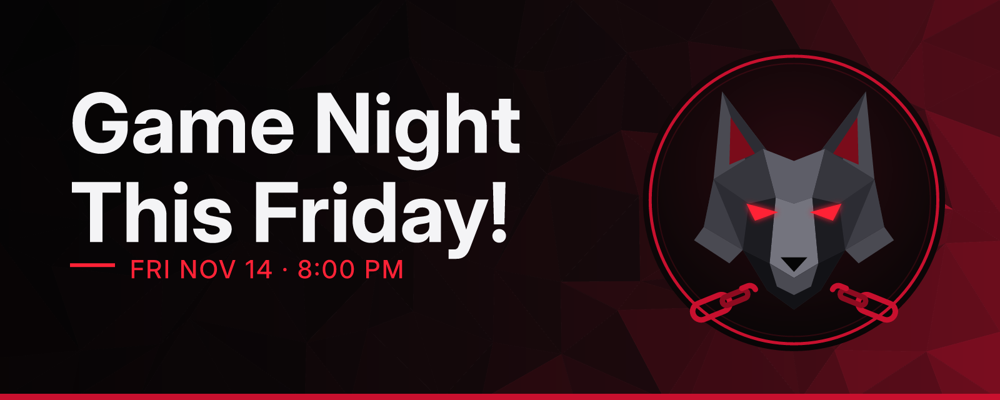

# Fenris Bot

An all-in-one bot for running a Discord server: eye-catching announcements, Discord calendar events, polls, and Claude-powered chat replies.

## Roadmap

1. **Foundation** (done): project setup, slash command framework, `/ping`, invite link.
2. **Management commands** (done): `/announce`, `/event`, `/poll`. Scheduled posting comes later, once the bot has storage.
3. **Claude in chat** (done): mention the bot to talk to it; plain-English requests turn into announcements, events, and polls after a Confirm button.
4. **Asset generation** (done): free banner and event cover images in five styles. Paid image models (Gemini, ChatGPT) are deliberately left out for now.

## Setup (about 10 minutes)

You need [Node.js 20+](https://nodejs.org/).

### 1. Create the bot in Discord
1. Go to the [Discord Developer Portal](https://discord.com/developers/applications) and click **New Application**. Name it.
2. On **General Information**, copy the **Application ID**.
3. On **Bot**, click **Reset Token** and copy the token. Treat it like a password: never share or commit it.
4. Still on **Bot**, turn on **Server Members Intent** (welcome cards and auto-role) and **Message Content Intent** (chat replies), then **Save Changes**.

### 2. Configure
```bash
npm install
cp .env.example .env
```
Fill in `.env` with the token, Application ID, and your server ID (in Discord: Settings > Advanced > Developer Mode on, then right-click your server > Copy Server ID).

### 3. Invite it and run it
```bash
npm run invite            # prints the invite link; open it and pick your server
npm run deploy-commands   # registers the slash commands in your server
npm run dev               # starts the bot (auto-restarts on code changes)
```
Type `/ping` in your server. A "Pong!" embed means everything works.

## Commands

| Command | Who can use it | What it does |
|---|---|---|
| `/ping` | Everyone | Checks the bot is online. |
| `/announce` | Manage Messages | Opens a form for a title, message, and footer, then posts a styled embed. Options: channel, `when` (schedule it for later), `repeat` (daily, weekly, every 2 weeks, or monthly at the same local time), color, `title_font`, emoji `divider`, banner image or generated banner, @here/@everyone, a role ping, and a link button. Type `:emoji_name:` in the message to use your server's custom emoji. |
| `/schedule list` / `/schedule cancel` | Manage Messages | See or cancel announcements waiting to be posted, including recurring ones (🔁). |
| `/event create` | Manage Events | Adds an event to the server calendar. `start` understands things like `fri 8pm`, `tomorrow 7:30pm`, `11/14 8pm`, or `2026-11-14 20:00`. Can use a voice channel or a place/link, a cover image, and post an announcement with the event link. |
| `/event list` | Manage Events | Shows upcoming events with times in each viewer's own time zone. |
| `/event cancel` | Manage Events | Cancels an event (pick it from the suggestions). |
| `/poll` | Everyone | Starts a native Discord poll with 2 to 10 answers, a duration, and optional multiple choice. |
| `/fancy` | Everyone | Turns text into fancy Unicode fonts (bold, script, gothic, double-struck, small caps, bubble, wide, upside down, and more) with optional emoji dividers. Shows all styles to copy, or posts one. |
| `/banner` | Everyone | Generates a banner image from a title and optional subtitle, in a choice of styles, with the server icon, the Fenris wolf, or no emblem. |
| `/settings` | Manage Server | One place to set Fenris up for your server. `view` shows everything; `welcome` sets the welcome channel, message (`{user}`, `{name}`, `{server}`, `{count}`), card style, and auto-role; `faq` opens a form for facts Claude should know. Other subcommands (mod log, tickets, levels, reminders, recap) switch on features as they arrive. |
| `/roles` | Manage Roles | Posts a self-serve role panel: up to 15 roles as buttons. Members click to add a role and click again to remove it. Roles with admin or moderator permissions, and roles above Fenris's own role, are refused. |
| `/warn add` / `list` / `clear` | Timeout Members | Warns a member (they get a DM), keeps a history with IDs, and clears one or all warnings. |
| `/timeout set` / `remove` | Timeout Members | Mutes a member for `10m`, `2h`, `1d`, `1h30m` (up to 28 days), or lifts it early. |
| `/purge` | Manage Messages | Deletes up to 100 recent messages, optionally only from one person or only bots. Skips pinned messages and anything older than 14 days. |
| `/automod setup` / `status` / `off` | Manage Server | Turns on Discord's own AutoMod: profanity and slur filter, invite-link blocking, spam detection, a mention limit, and your own blocked words. Discord enforces these even if Fenris is offline. |
| `/catchup` | Everyone | Claude privately sums up what you missed in a channel: since your last message, or the past N hours. |
| `/recap` | Manage Server | Claude posts a recap of the past 7 days across the server, with a banner, right now. |

**Mod log:** pick a channel with `/settings modlog` and Fenris posts deleted and edited messages, joins (flagging brand-new accounts), leaves, bans, unbans, and every `/warn`, `/timeout`, `/purge`, and AutoMod block there.

**Weekly recap:** set a channel with `/settings recap` and every Sunday at 6 PM Claude posts highlights from the week and upcoming events. **Server FAQ:** `/settings faq` opens a form for rules, links, schedules, and anything else Claude should know when members ask. You can also mention Fenris and say "catch me up" in any channel. `/catchup` and chat count toward `CHAT_DAILY_LIMIT`, and each recap counts as 5.

**Event reminders:** set a channel with `/settings reminders` and Fenris posts a reminder 1 day before each calendar event and again 1 hour before, pinging everyone who clicked **Interested**.

**Welcome cards:** with `/settings welcome` set, every new member gets a red and black card with their avatar, name, and member number, and the auto-role if you picked one. Fenris's role must sit above any role it hands out (Server Settings > Roles, drag Fenris up).

**Generated art:** `/announce` has a `banner` option and `/event create` has a `cover_style` option that make a matching image automatically (title, server name or event date, and your server's icon, or the Fenris wolf if the server has no icon). Claude chat adds them to its drafts too. Images are drawn on your own computer, so they cost nothing.



Times typed into commands are read in the `TIMEZONE` from `.env` (default `America/Chicago`). You can change who sees each command in Server Settings > Integrations > Fenris.

The bot registers its slash commands every time it starts, so new commands appear after a restart. (`npm run deploy-commands` still works if you want to update them without restarting.)

## Claude chat (optional)

Mention Fenris (or reply to one of its messages) and it answers using Claude (it can also schedule announcements and use fancy fonts and dividers when asked), with the last 20 messages of the channel as context. Ask it things like *"@Fenris announce game night Friday at 8 in #general and make an event for it"* and it drafts the post, shows a preview, and waits for you to press **Confirm**. Only the person who asked can confirm, and they need the same permission the slash command would need.

To turn it on:
1. At [console.anthropic.com](https://console.anthropic.com/), add some prepaid credit, then create a key under **API Keys**.
2. In the [Developer Portal](https://discord.com/developers/applications), open your app > **Bot** and switch on **Message Content Intent**.
3. Put the key after `ANTHROPIC_API_KEY=` in `.env` and restart the bot. The terminal says "Claude chat is ON".

Costs stay predictable: chat is off without a key, each person has a short cooldown, and `CHAT_DAILY_LIMIT` caps replies per day (default 200). `CLAUDE_MODEL` picks the model: `claude-opus-5-5` (default) is the smartest, `claude-haiku-5-5` costs a small fraction as much.

## Running it 24/7 on Railway

Fenris is set up to run on [Railway](https://railway.com/) (about $5/month on the Hobby plan, after a free trial). Railway builds it from the `Dockerfile` and restarts it if it ever crashes.

1. Go to [railway.com](https://railway.com/), sign in with GitHub, and pick the Hobby plan when asked.
2. Click **New Project** > **Deploy from GitHub repo** and choose `fenris_bot`. If it isn't listed, click **Configure GitHub App** and give Railway access to that repo.
3. Open the new service, go to the **Variables** tab, click **Raw Editor**, paste in everything from your `.env` file, and save. Railway redeploys with your settings.
4. Open **Deployments** > the latest one > **Deploy Logs**. You should see "Logged in as Fenris Bot..." and "Slash commands up to date".
5. **Stop the copy on your computer** (Ctrl+C in its terminal). If both run at once, Fenris answers everything twice.

No domain or port is needed, since the bot connects out to Discord.

6. **For scheduled announcements:** right-click the service on the project canvas (or use the command palette) and choose **Attach Volume**, with mount path `/app/data`. That's where schedules are saved. Without a volume, anything scheduled is lost whenever Railway redeploys.

**Updating:** every time a pull request is merged into `main`, Railway rebuilds and restarts Fenris on its own, and the bot re-registers its slash commands at startup. To change a setting (like `CLAUDE_MODEL`), edit it in the Variables tab.

**Running locally instead:** `npm run dev` still works for testing; just stop the Railway service first (or use a second test bot) so two copies don't run at once.

## Adding a command

Create a file in `src/commands/`, export a `Command`, add it to the list in `src/commands/index.ts`, then run `npm run deploy-commands`.
